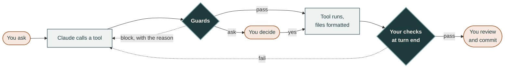

<picture>
  <source media="(prefers-color-scheme: dark)" srcset="docs/assets/claude-kit-lockup-dark-bg.svg">
  
</picture>

# claude-kit

**Ship with confidence.**

Claude Code treats your rules as advice. A rule in CLAUDE.md, a skill, or a prompt is something it can skip, and you find out in review. claude-kit runs those rules as hooks on every command, edit, plan, subagent report, and stop, and sends Claude back when it breaks one. What reaches you has been checked: its claims against what Claude read, its code against your project's own checks, its prose for AI filler. Claude stops for your review after every step, so each review is one step long.

It also brings 48 commands for the work around the code (audits, ADRs, runbooks, PR reviews, dependency PRs, retros) and 7 agents, each detecting your stack, your code host, and the tools you've connected.

```sh
claude plugin marketplace add ku5ic/claude-kit
claude plugin install kit@ku5ic
```

Works in any repo on macOS and Linux with the defaults in `kit.yml`. It's built for one engineer. There's no team policy layer and no Windows support.

**It isn't an autopilot.** You approve the plan, review each step, and commit. The kit makes each review shorter, because what reaches you has already been checked.

## What you get

Each row is a correction round you no longer spend. The mechanism, and every exception, is in [docs/guards.md](docs/guards.md) and [docs/checks.md](docs/checks.md).

| You get                                                         | How                                                                                                                                                                                  |
| --------------------------------------------------------------- | ------------------------------------------------------------------------------------------------------------------------------------------------------------------------------------ |
| Plans, reports, and posts that state only what Claude read      | A second model checks each claim against the session's tool results and sends back the ones nothing confirms. A `file:line`, path, or SHA that doesn't exist is caught with no model |
| A plan checked against the repo before you approve it           | `kit:plan-critic` reads it, sending its fact questions to `kit:gatherer` runs in parallel; a resubmit lists what changed                                                             |
| One step to review at a time                                    | Claude stops after every plan step, with a review sheet that puts lockfiles, configs, and unplanned files first                                                                      |
| The say in which review findings get fixed                      | After a `/code-review`, code edits wait until you answer                                                                                                                             |
| "Done" that means your checks pass                              | Your git hooks' checks run on the files Claude edited. A failure that also shows on the git base doesn't block, and Claude runs the full gate when you ask                           |
| No old warnings blocking a small edit                           | Linters block only on lines Claude changed                                                                                                                                           |
| No green bought by skipping a test or silencing a linter        | Blocked unless the line says why (`kit: allow <reason>`). An edit that changes a task your checks run asks first                                                                     |
| No imports of packages that may not exist                       | Blocked until your manifest declares the package or its registry has it                                                                                                              |
| Your project's tools, at your project's versions                | Binaries resolve from `node_modules`, `.venv`, `go tool`, and version pins first, and never through `npx` or `pnpm dlx`                                                              |
| Files formatted by your own fixers and config                   | Each edit runs the fixers your git hooks would run on it                                                                                                                             |
| No `rm -rf` on the wrong path, no force push to main            | Every command is parsed with a bash parser, through pipelines, `$(...)`, and `sudo` or `env` wrappers. History git can't bring back asks first                                       |
| `.env`, SSH keys, and cloud and cluster credentials off limits  | Blocked through the file tools, a local file server's MCP tools, and every parsed command. [SECURITY.md](SECURITY.md#known-gaps) lists what parsing can't see                        |
| Commits without AI signatures or secrets, and only when you ask | Blocked at commit time, with `gitleaks` when installed; your commit-msg hooks check the message                                                                                      |
| Files, commits, PRs, and posts without AI filler                | Sent back with each line and its fix                                                                                                                                                 |
| UI that uses only the design tokens your project defines        | An undefined token is blocked                                                                                                                                                        |
| Your rules ahead of output styles and harness defaults          | A system-prompt section and a reminder on every prompt put the kit's rules first, reply length and the step pause included                                                           |
| Advice that fits your stack, in subagents too                   | Pattern skills load for the files and dependencies your repo has, and every subagent gets the same rules and repo context                                                            |
| No `out.log` or downloads in your repo root                     | Temporary files go to `.claude/scratch/`, pruned once a day after 30 days                                                                                                            |
| A kit bug that never blocks you                                 | A crashing hook fails open, and the session's first one is shown to you                                                                                                              |

Permission rules alone can't do this. A prefix rule can't tell `git push` from `git push --force origin main`, never sees a command inside a pipeline, and a plugin can't ship deny rules at all. Hooks can.

## How a session runs



Nothing to learn up front. After install:

| When                  | The kit                                                                                                          |
| --------------------- | ---------------------------------------------------------------------------------------------------------------- |
| A session starts      | Loads the rules, your stack, your check commands, and the pattern skills that fit                                |
| Claude runs a command | Blocks the dangerous ones, asks about the ambiguous ones, checks any file it changed                             |
| Claude edits a file   | Keeps credential files off limits to every file tool, wants a reason for a skipped test, runs your formatter     |
| Claude plans          | Has plan-critic read it against the repo and checks its claims before you approve; a resubmit lists what changed |
| A step ends           | Hands you a review sheet: lockfiles, configs, markers, and unplanned files first                                 |
| A subagent reports    | Sends back AI tells, unconfirmed claims, and an over-long report before Claude reads it                          |
| A `/code-review` ends | Holds code edits until you pick which findings to fix                                                            |
| Claude commits        | Blocks AI signatures and secrets; your commit-msg hooks check the message                                        |
| Claude says done      | Runs your git hooks' checks on what it edited                                                                    |
| Claude replies        | States the turn's reply target, checks the reply's bare references, and reminds it to check its claims           |

**Block** means Claude gets the reason and tries another way; you aren't interrupted. **Ask** is a normal permission prompt with the reason in it. Every guard, and which of the two it does: [docs/guards.md](docs/guards.md).

What Claude gets back when it tries `git push --force origin main`:

```text
kit bash: BLOCKED git push --force

do    use --force-with-lease if you must

rule  git-force-push
cmd   git push --force origin main
```

## How you work with it

For anything bigger than a one-line fix, the kit holds Claude to five stages. Each one removes a way a session usually goes wrong:

| Stage                | You                                       | Without it                                  | With the kit                                                                                                  |
| -------------------- | ----------------------------------------- | ------------------------------------------- | ------------------------------------------------------------------------------------------------------------- |
| 1. Ask               | "How does X work?"                        | Claude starts editing when you only asked   | `investigate` loads, reads the code, and edits nothing                                                        |
| 2. Plan              | `/plan` (built in)                        | You approve a plan nobody checked           | `kit:plan-critic` reads it against the repo, and its claims are checked, before you're asked to approve       |
| 3. Review each step  | Approve the plan                          | Claude runs through the whole plan at once  | Claude stops after every step so you can review and commit. The Stop hook has already checked what it touched |
| 4. Review the change | `/code-review`, then `/verify` (built in) | "Done" while checks fail                    | `/code-review`'s hook runs the full gate, and you pick the findings to fix; `/verify` watches the change work |
| 5. Ship              | `/write-commit`, `/pr-description`        | Commits you didn't ask for, AI-sounding PRs | Messages and PR text in your project's style, checked for AI tells. Claude never commits or pushes unasked    |

## Commands

Only you start a command, by typing it. Each detects your stack, your code host (`gh`, `glab`, or the host's MCP connector), and the tools you've connected, and asks when it can't tell. Every one, with when to use it: [docs/commands.md](docs/commands.md).

| Group  | Count | For                                                                                                                              | For example                       |
| ------ | ----- | -------------------------------------------------------------------------------------------------------------------------------- | --------------------------------- |
| Audit  | 14    | A read-only report, its claims checked, then the read-only checks that need a running system (`tofu plan`, axe), run on your yes | `/audit-security`, `/audit-tests` |
| Code   | 10    | Understanding a change before making it: impact, history, contracts, a challenge to a plan or PR                                 | `/code-impact`, `/code-challenge` |
| Write  | 11    | A document in your project's format: ADRs, RFCs, runbooks, retros, tickets                                                       | `/write-adr`, `/write-runbook`    |
| PR     | 5     | Your PRs and other people's. Nothing is posted until you run `/pr-publish` on a draft you've read                                | `/pr-description`, `/pr-review`   |
| Meta   | 6     | The kit and your sessions: retros on transcripts, new pattern skills, how often each rule fired                                  | `/meta-retro`, `/kit-stats`       |
| Others | 2     | Dependency PRs and security alerts, and AI tells in a text                                                                       | `/deps`, `/unslop`                |
| Agents | 7     | One job each, with a boundary: the debugger hands the fix back, the tester never changes code to make a test pass                | `kit:plan-critic`, `kit:debugger` |

## Tune it

Eight dials are rows in Claude Code's `/config`, each titled `Kit:`:

| Row                        | Choices                            |
| -------------------------- | ---------------------------------- |
| Kit: preset                | `standard`, `light`, `strict`      |
| Kit: step pause            | `step`, `plan`, `off`              |
| Kit: gate receipt          | `all`, `failures`                  |
| Kit: reply length          | `terse`, `moderate`, `explanatory` |
| Kit: reply slack           | `none`, `25%`, `50%`, `100%`       |
| Kit: rules take precedence | on, off                            |
| Kit: /kit-stats command    | on, off                            |
| Kit: subagent rows         | on, off                            |

`light` means one review per plan, no plan-critic or claim-check passes, and no skill nudges; `strict` requires pattern skills before the first edit of a file type. Every other override goes in `~/.claude/claude-kit.local.yml`: [docs/configuration.md](docs/configuration.md).

## What it costs

More per turn. The bash hook takes about 25 ms. The claim checker is a Haiku run capped at $1 and 240 seconds (`kit.yml` `claims:`); each statement is checked once per session, and a confirmed one that cites a file keeps its verdict in later sessions while HEAD and the file are unchanged. Every block is a turn you wait through.

## Requirements

Needs `git`, bash, and `curl`, on macOS or Linux. A fresh macOS asks for the Command Line Tools the first time `git` runs, and some Linux installs lack `git` or `curl`: [dependencies](docs/dependencies.md) says what each already has. The plugin runs in Claude Code only; claude.ai chat has [its own zip](docs/chat.md).

## Get the most out of it

The kit is opinionated about tools: it steers Claude to `rg`, `fd`, `ast-grep`, and `jq` over the stock ones, and most of them aren't preinstalled.

- **Install `ast-grep` and `jq`.** With `ast-grep`, Claude lists every file that uses the one it's about to change; `/meta-retro` needs `jq`. The [dependencies](docs/dependencies.md) page says what each other tool adds.
- **Log in the `claude` CLI.** Once per repo, Haiku sorts your CI and hook commands into checks and fixers, and plans, reports, and posts get their claims checked.
- **Connect your code host.** `gh`, `glab`, or the host's MCP connector runs the `/pr-*` commands and `/deps`.
- **Gitignore `.claude/scratch/` and `.claude/plans/`**, globally or per repo. The kit never edits your ignore files.
- **Write your own CLAUDE.md:** copy `templates/CLAUDE.md` to `~/.claude/CLAUDE.md` and fill it in.

## Learn more

| Page                                           | What's in it                                                                                  |
| ---------------------------------------------- | --------------------------------------------------------------------------------------------- |
| [docs/commands.md](docs/commands.md)           | Every command and agent: what it does, when to use it                                         |
| [docs/skills.md](docs/skills.md)               | The skills Claude loads on its own for your stack, and when each loads                        |
| [docs/guards.md](docs/guards.md)               | Every guard, what it stops, whether it blocks or asks, and what to do when one is in your way |
| [docs/checks.md](docs/checks.md)               | Which of your project's checks run before "done", and how tools are resolved                  |
| [docs/rules.md](docs/rules.md)                 | The seven rule files, and why each says what it says                                          |
| [docs/configuration.md](docs/configuration.md) | Presets, every overlay key, and what's on by default                                          |
| [docs/dependencies.md](docs/dependencies.md)   | What to install, what a fresh macOS or Linux already has, and what each tool adds             |
| [docs/cli.md](docs/cli.md)                     | The `kit` CLI, how it's built, the status line, and shell completion                          |
| [docs/chat.md](docs/chat.md)                   | The smaller plugin for claude.ai chat                                                         |

## Develop

Setup, tests, and how a change gets released: [CONTRIBUTING.md](CONTRIBUTING.md).
