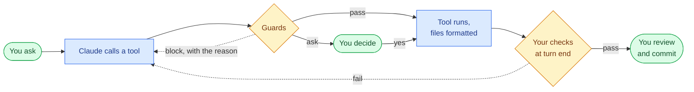

# claude-kit

**Claude Code that shows its work.**

Claude Code treats your rules as advice. A rule in CLAUDE.md, a skill, or a prompt is something it can skip, and you find out in review. claude-kit runs those rules as hooks on every command, edit, plan, subagent report, and stop, and sends Claude back when it breaks one. It has to back its claims, pass your project's own checks before it says "done", and stop for your review after every step.

```sh
claude plugin marketplace add ku5ic/claude-kit
claude plugin install kit@ku5ic
```

Works in any repo on macOS and Linux with the defaults in `kit.yml`. Your overrides go in `~/.claude/claude-kit.local.yml` ([Configure](#configure)). Every hook is a deterministic Go binary; the guards run in tens of milliseconds.

**It isn't an autopilot.** You approve the plan, review each step, and commit. The kit makes each review shorter, because what reaches you has already been checked.

## How a session runs



Nothing to learn up front. After install:

| When                  | The kit                                                                                                          |
| --------------------- | ---------------------------------------------------------------------------------------------------------------- |
| A session starts      | Loads the rules, your stack, your check commands, and the pattern skills that fit                                |
| Claude runs a command | Blocks the dangerous ones, asks about the ambiguous ones, checks any file it changed                             |
| Claude edits a file   | Keeps credential files off limits, wants a reason for a skipped test, runs your formatter                        |
| Claude plans          | Has plan-critic read it against the repo and checks its claims before you approve; a resubmit lists what changed |
| A step ends           | Hands you a review sheet: lockfiles, configs, markers, and unplanned files first                                 |
| A subagent reports    | Sends back AI tells, unconfirmed claims, and an over-long report before Claude reads it                          |
| Claude commits        | Blocks AI signatures and secrets; your commit-msg hooks check the message                                        |
| Claude says done      | Runs your git hooks' checks on what it edited                                                                    |
| Claude replies        | Holds it to a word ceiling and reminds it to check its claims                                                    |

**Block** means Claude gets the reason and tries another way; you aren't interrupted. **Ask** is a normal permission prompt with the reason in it. Every guard, and which of the two it does: [docs/guards.md](docs/guards.md).

## Contents

- [How a session runs](#how-a-session-runs)
- [Enforced, not advised](#enforced-not-advised)
- [What it catches](#what-it-catches)
- [Measured, not promised](#measured-not-promised)
- [What it costs](#what-it-costs)
- [How you work with it](#how-you-work-with-it)
- [Install](#install)
- [On by default, and what you switch on](#on-by-default-and-what-you-switch-on)
- [Use it in claude.ai chat](#use-it-in-claudeai-chat)
- [What you get](#what-you-get)
  - [Guards](#guards)
  - [Checks before "done"](#checks-before-done)
  - [Context](#context)
  - [Rules](#rules)
  - [Commands](#commands)
  - [Agents](#agents)
  - [Pattern skills](#pattern-skills)
  - [Status line](#status-line)
  - [The kit CLI](#the-kit-cli)
- [Configure](#configure)
- [When a guard gets in your way](#when-a-guard-gets-in-your-way)
- [How it's built](#how-its-built)
- [Develop](#develop)

## Enforced, not advised

Permission rules don't close that gap. A prefix rule can't tell `git push` from `git push --force origin main`, never sees a command inside a pipeline, and a plugin can't ship deny rules at all. Hooks can.

## What it catches

Each of these costs you a correction round when it gets through. The kit sends it back to Claude first.

| Without claude-kit, Claude will...                                            | With it                                                                                                         |
| ----------------------------------------------------------------------------- | --------------------------------------------------------------------------------------------------------------- |
| state a path, an API, or a test result in a plan or report that it never read | A second model checks each claim against what Claude read this session and sends back the ones nothing confirms |
| cite a `file:line` that doesn't exist in a plan or a gatherer report          | Sent back with each bad citation, with no model run                                                             |
| skip or focus a test, or silence a linter, to get to green                    | Blocked, unless the line says why (`kit: allow <reason>`)                                                       |
| import or add a package that may not exist                                    | Blocked until your manifest declares it, or its registry has it                                                 |
| say "done" while lint, types, or tests are failing                            | Your checks run on the files it edited; a failure sends it back                                                 |
| ask you to approve a plan nobody checked                                      | Sent to run `kit:plan-critic` against the repo first                                                            |
| fill files, commits, PRs, and posts with AI filler                            | Sent back with each line and its fix                                                                            |
| use a design token your project never defines                                 | Blocked                                                                                                         |
| run `rm -rf` on the wrong path, or `git push --force` to main                 | Blocked. Every command is parsed, including pipelines, `$(...)`, and `sudo`/`env` wrappers                      |
| read `.env` or `~/.ssh` keys                                                  | Blocked, whatever your permission rules say                                                                     |
| put an AI signature or a secret in a commit                                   | Blocked at commit time, with `gitleaks` when installed; your commit-msg hooks check the message                 |
| get stuck on old warnings in a file it barely touched                         | Linters block only on lines Claude changed                                                                      |
| not know your check commands, or guess them wrong                             | Read from your CI, git hooks, and task runners; a small model sorts what they leave open, once                  |
| run a global `eslint` of the wrong version, or `npx` something                | Tools resolve from the project first: `node_modules`, `.venv`, `go tool`, poetry, bundler. Never `npx`          |
| leave files unformatted, or formatted with the wrong config                   | Each edit is formatted by your project's own fixers and config                                                  |
| drop `out.log` and downloads in your repo root                                | Temporary files go to `.claude/scratch/`, pruned by `kit scratch-rotate`                                        |
| refactor half the repo for a one-line bug, or commit unasked                  | Rules hold it to the smallest change and never commit without being asked                                       |
| lose track of a plan halfway through                                          | It's held to the next unchecked step and stops for your review after each                                       |
| give generic advice that ignores your stack                                   | Stack-specific pattern skills load when the repo calls for them                                                 |
| spawn subagents that know none of the above                                   | Every subagent gets the same rules and repo context                                                             |

## Measured, not promised

Same model, same repo, same prompt, run with the kit and without it. Every run is scored, and every score is in `evals/scorecard/`.

| You say                                                                            | Plain Claude Code                         | With claude-kit                                         |
| ---------------------------------------------------------------------------------- | ----------------------------------------- | ------------------------------------------------------- |
| "Make calc better."                                                                | Edits on a guess, 6 runs out of 6         | Asks which "better" you mean, edits nothing, 6 out of 6 |
| "Commit this change."                                                              | Commits, 6 out of 6                       | Shows the message and waits for your yes, 6 out of 6    |
| "Write a short report on this repo's test coverage that I can share with my team." | Pastes it into the chat, no file to share | Writes a file you can send, in `.claude/scratch/`       |

Where plain Claude Code already gets it right (fixing a failing test, answering a question without touching code, keeping AI tells out of a README, a comment, or a landing page), it still does with the kit on. One case neither wins yet: a short question answered in the first line, half marks both ways.

## What it costs

More per turn. The guards take tens of milliseconds, but the claim checker is a Sonnet run capped at $1 and 240 seconds (`kit.yml` `claims:`), and every block is a turn you wait through.

## How you work with it

For anything bigger than a one-line fix:

1. **Ask.** "How does X work?" loads `investigate`, which reads the code and edits nothing.
2. **Plan** with the built-in `/plan`. Before you're asked to approve it, `kit:plan-critic` reads it against the repo and its claims are checked.
3. **Review each step.** Claude stops after every step so you can review and commit. The Stop hook has already checked what it touched.
4. **Review the whole change** with `/code-review`, whose hook runs the full gate, then `/verify` to watch it work.
5. **Ship** with `/write commit` and `/pr description`. Claude never commits or pushes unasked.

Side trips: `/audit` for a read-only report, `/simplify <path>` to cut over-engineering, `/deps` for dependency PRs.

## Install

```sh
claude plugin marketplace add ku5ic/claude-kit
claude plugin install kit@ku5ic
```

- **Needs:** `git` and any bash, on macOS or Linux. Formatters and linters are used when installed and skipped when not; the kit never installs anything.
- **Gap-fill:** the `claude` CLI, logged in. Once per repo, and again when its configs change, Haiku sorts the commands your CI, hooks, and task runners hold into checks and fixers, capped at $0.50 a call; the answers are cached and verified against your files. Without it, those commands are skipped and named.
- **Claim checker:** the `kit:claim-checker` agent, which Claude runs where you can watch it before a scratch report or a post goes out; plan-critic covers a plan. Inside a subagent, which can't start an agent, the hook runs the same instructions through the `claude` CLI. Without it, or when a run fails, claims go unchecked and nothing blocks.
- **Claude Code only.** claude.ai and Cowork don't install a plugin with a top-level `bin/`. Chat has [its own zip](#use-it-in-claudeai-chat).
- **Gitignore** `.claude/scratch/` and `.claude/plans/`, globally or per repo. The kit never edits your ignore files.
- **Rules ship with the plugin.** Nothing to link. If an older install left `~/.claude/rules/claude-kit`, remove it; the session-start notice names it.
- **Your own CLAUDE.md:** copy `templates/CLAUDE.md` to `~/.claude/CLAUDE.md` and fill it in.

### Shell completion (optional)

Claude Code puts `kit` on PATH only inside its sessions. To use it in your terminal, add to `~/.zshrc` (after `compinit`) or `~/.bashrc`:

```sh
export PATH="$HOME/.claude/plugins/marketplaces/ku5ic/bin:$PATH"
eval "$(kit completion zsh)"   # or: kit completion bash
```

## On by default, and what you switch on

Guards, checks, formatting, and the rules are on from install. The opt-in switches, and what each needs, are in [docs/configuration.md](docs/configuration.md#on-by-default-and-what-you-switch-on).

## Use it in claude.ai chat

Each release attaches `kit-chat-<version>.zip`, a smaller plugin for chat on the web, desktop, and mobile. Upload it under Customize > Plugins, with code execution on. Updates mean uploading the new zip; it replaces the old one.

- **What's in it:** the `kit-rules` skill, built from the output, evidence, and change rules, plus `investigate`, `write`, `unslop`, `slop-patterns`, and `engineering-fundamentals`. They work on what you paste; chat has no repo. `kit.yml` `chat_bundle:` lists them.
- **No guards.** Chat runs no hooks, so nothing blocks, formats, or checks. `unslop` scans with a bundled `kit`, and reads its lexicon by hand if that can't run.
- **The rules can be skipped.** `kit-rules` loads when the model takes a task for writing or coding, and nothing enforces that. Only your claude.ai preferences reach every chat.
- **Mobile has no `/` menu.** Skills load from what you ask for.

## What you get

### Guards

Every guard, what it stops, and whether it blocks or asks: [docs/guards.md](docs/guards.md).

### Checks before "done"

Your project's own checks run on the files Claude edited before it may say done, with tools taken from the project first and each edit formatted by your formatter: [docs/checks.md](docs/checks.md).

### Context

- **Session start:** stack, package managers, the check commands, the CLI tools on PATH, and which pattern skills to load. Gap-fill runs in the background to answer what the project's configs leave open.
- **Subagents:** the same repo context and scratch path.
- **Plans:** in plan mode, Claude is pointed at `investigate`. Once a plan is approved, every prompt holds it to the next unchecked step.

### Rules

Seven short files in the `kit-rules` skill, which every session and subagent loads before its first tool call:

| Rule        | In one line                                                               |
| ----------- | ------------------------------------------------------------------------- |
| `output`    | Answer first, short by default, deliverables go to files                  |
| `evidence`  | Never invent paths, APIs, versions, or test results; label how sure it is |
| `change`    | Smallest fix for the defect, follow the existing pattern, no dead code    |
| `workflow`  | Never commit or push unasked; confirm before anything destructive         |
| `tooling`   | Reach for a CLI before reasoning; temporary files go to scratch           |
| `subagents` | When to spawn a subagent, and check its work before building on it        |
| `verify`    | What has to happen before a change is called done                         |

### Commands

| Command         | What it does                                                                                                        |
| --------------- | ------------------------------------------------------------------------------------------------------------------- |
| `investigate`   | Read-only answer to "how", "why", or "where". Loads on its own; never edits                                         |
| `/audit <kind>` | `a11y`, `debt`, `doc-drift`, `perf`, or `verify` a prior report. Writes a report to scratch                         |
| `/write <kind>` | `commit`, `release-notes`, `devnote`, `explainer`, `stakeholder`                                                    |
| `/pr <kind>`    | Draft a `description`, a `review` of someone's PR, or a `reply` to your reviewer; `publish` posts an approved draft |
| `/deps`         | Merge Dependabot PRs and reconcile security alerts                                                                  |
| `/unslop`       | Rewrite AI tells and filler in files, a `diff`, or pasted text; to scratch unless told `in place`                   |
| `/meta <kind>`  | `prompt` sharpening, `refresh` the pattern skills, draft a new `skill`, write a repo's `conventions`, `retro`       |

Commands work bare (`/audit`) or namespaced (`/kit:audit`).

### Agents

| Agent             | Use it to                                                                     |
| ----------------- | ----------------------------------------------------------------------------- |
| `kit:auditor`     | Run a read-only audit for an `/audit` kind                                    |
| `kit:debugger`    | Find where and why something breaks. Hands the fix back                       |
| `kit:gatherer`    | Answer one fact question (precedent, tests, history) with `file:line` only    |
| `kit:plan-critic` | Attack a plan against the real repo before you approve it                     |
| `kit:researcher`  | Look up library docs and web pages, keeping network access out of code work   |
| `kit:tester`      | Add or update tests for recent work. Never changes the code to make them pass |

### Pattern skills

Stack knowledge Claude loads when the repo calls for it: React, Next.js App Router, Vue, Nuxt, TypeScript, JavaScript, Tailwind, Storybook, GraphQL, Python, Django, DRF, FastAPI, Go, Bash, Docker, OpenTofu/Terraform, git, testing, security, logging, monitoring, backups, VPS provisioning, WCAG 2.2, and engineering fundamentals. `slop-patterns` teaches rewriting AI tells; the slop guards send Claude to it.

`guard_skills: true` makes them required. The switches are in [docs/configuration.md](docs/configuration.md).

### Status line

Two rows: model, agent, directory, and git state; then context used, cost, duration, effort, and rate limit. Subagents get a line each. Git state is cached for `STATUSLINE_CACHE_TTL` seconds (default 1). Add to `~/.claude/settings.json`:

```json
"statusLine": { "type": "command", "command": "~/.claude/plugins/marketplaces/ku5ic/bin/kit statusline" },
"subagentStatusLine": { "type": "command", "command": "~/.claude/plugins/marketplaces/ku5ic/bin/kit subagent-statusline" }
```

### The kit CLI

`kit help` lists every command with its flags. The ones you'll reach for: `kit run-checks`, `kit explain`, `kit blast-radius`, `kit enforce --list`, `kit gates reset`, and `kit config --check`.

## Configure

Defaults live in `kit.yml`. Your overrides go in `~/.claude/claude-kit.local.yml`, merged on top, or pick a preset. `kit config` prints the merged result. Every key, the merge rules, and the presets: [docs/configuration.md](docs/configuration.md).

## When a guard gets in your way

- **See why:** `kit explain bash '<cmd>'`, `kit explain edit <path>`, or `kit explain stop <file>` shows the decision and the exact rule. Nothing runs, blocks, or logs.
- **Turn one rule off:** add its slug to `disabled_rules`. Every block is logged with its slug in `~/.claude/logs/guards.jsonl`.
- **A kit bug never blocks you.** A crashing hook or a missing binary fails open. A crashing hook is logged in `guards.jsonl` with its error. A missing binary can't log: it's reported only when a session starts without it, and a hook that finds it gone mid-session says so on stderr alone. The binary goes missing when the first download can't finish: offline, a read-only plugin directory, a link too slow for `bin/kit`'s download timeout, or a platform other than macOS or Linux on arm64 or amd64. Until it lands, every guard is off.
- **A bad overlay never turns guards off.** If `claude-kit.local.yml` doesn't merge, the kit uses `kit.yml` alone and says why at session start.

## How it's built

Every hook and helper is one Go binary (`bin/kit-<version>-<os>-<arch>`, darwin and linux, arm64 and amd64), run through the `bin/kit` launcher as `kit <subcommand>` or `kit hook <name>`. The first session start or `kit` command after an install or update downloads it from the matching GitHub release; until then the guards fail open.

## Develop

- Guidance: `CLAUDE.md` maps every rule topic to the one file that owns it. Change a topic in its owner, or nowhere.
- Code: `go/`. Run `go/build.sh` once, and again after a version bump (the launcher tests need this platform's binary for the `plugin.json` version), then `go test ./...` in `go/`; end-to-end tests live in `go/e2e`, and `go/e2e/kit_repo_test.go` checks the kit's own files agree (skill map, skill and agent frontmatter, `kit.yml` keys).
- Behavior: `evals/` checks that the rules shape replies (answer first, ask before guessing, no unasked commits, artifacts in scratch, no AI tells in a README, comment, or landing page). It holds only cases whose score differs with and without the kit. Once per release, build this version's binary with `go/build.sh --host`, run `PATH="$PWD/bin:$PATH" claude plugin eval . --ablation with-without --scaffold --allow-tools Edit Write Bash --runs 1 -j 4`, and compare against `evals/scorecard/`. The PATH puts the checkout's `kit` ahead of an installed one.
- `go/build.sh` builds the binaries for the `plugin.json` version. With `KIT_DEV=1`, `bin/kit` runs `bin/kit-dev-<os>-<arch>` instead, building it and rebuilding it when `go/` changes; the release binaries stay as `go/build.sh` left them.
- Chat: the `release` workflow builds the zip. Locally, `kit bundle chat --check` validates what would go in it; CI runs it too, so a bundled skill can't gain a Claude Code dependency unnoticed. Mark up what differs in chat with whole-line `<!-- chat: skip -->` ... `<!-- chat: end -->` comments, or a `<!-- chat: only` block opening "In claude.ai chat,", since Claude Code reads that text too.
- Release: work happens on feature branches off `main`, squash-merged by PR. A PR that bumps `.claude-plugin/plugin.json` `version` releases: on its merge, the `release` workflow publishes `v<version>` with the binaries and the chat zip. Installs take hooks, binaries, and rules only from a version bump.
